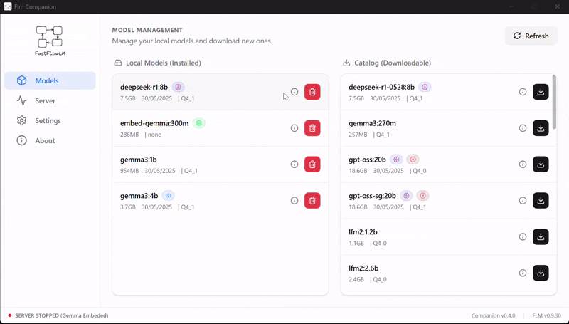

<div align="center">

<h1 style="border: none;">🤖 Flm Compagnon</h1>

[](https://github.com/FastFlowLM/FastFlowLM)

[](https://github.com/plushycat/flm-companion/releases)
[](https://github.com/plushycat/flm-companion/actions/workflows/main.yml)
[](LICENSE)

[](https://github.com/plushycat/flm-companion/releases)
[](https://tauri.app)

</div>

## What this fork adds and fixes

This fork keeps upstream FLM compatibility while making Companion a clearer local model launcher and serving client.

* **Serves only the active model**: Companion-owned API proxy presents a single active model at `/v1/models` instead of exposing every downloaded model.
* **Fixes model size reporting**: downloaded and existing models use their actual on-disk sizes.
* **Makes launch cost visible**: live free RAM, FLM process RAM, NPU usage, launch context versus model maximum, TTFT, context use, and context-aware RAM estimates.
* **Prevents stale FLM processes**: owned FLM processes are cleaned up on stop, restart, window close, and application exit.
* **Improves serving workflow**: server-first dashboard, chat connected to the active server, launch parameters in a modal, presets, collapsible navigation, and copy-ready Developer API examples.
* **Preserves working state**: selected model and launch settings persist between sessions.
* **Adds Caveman mode**: optional short, high-density replies for chat.

Built artifacts are published on the [fork releases page](https://github.com/plushycat/Flm-Companion/releases).

## 📝 Description

Flm Compagnon is a modern GUI designed to accompany and manage the **FastFlowLM (FLM)** project. It offers a smooth user experience to interact with your local AI models, monitor the server, and manage your configurations.

> [!IMPORTANT]
> This application requires **[FastFlowLM (FLM)](https://github.com/FastFlowLM/FastFlowLM)** to be installed on your system. Without it, Flm Compagnon will not function.

## ✨ Features

* **Models**: Model manager (download, delete, inspect details).
* **Server**: Configuration and management of the FLM server instance.
* **Resource Monitor**: Real-time NPU and RAM usage monitoring with historical charts when server is running.
* **Presets**: Save and manage custom server configurations as presets for quick access.
* **System Tray**: Quick access to server controls, **model selection**, **presets**, and status directly from the notification area.
* **Auto-Updates**: Automatic update check at startup for both FLM Companion and FastFlowLM with integrated installer.
* **Auto-start**: Option to launch the application automatically at Windows startup.
* **Start Minimized**: Option to launch the application minimized to the system tray (configurable in settings).
* **Settings**: Application customization.
* **About**: View application version, hardware information, FLM changelog, and check for updates.
* **Multilingual**: Interface management in **English, French, and Japanese**.
* **Theme**: Management of light and dark themes.

## 📸 Videos

### 🗂️ Interface


### 🔔 System Tray


## 📋 To do

<details>

<summary>Completed</summary>

* [X] Add NPU and RAM usage monitoring and display (real-time stats)
* [X] Clean code and optimisation
* [X] Fix the server management design for consistency
* [X] Add a version check for the companion application (+ changelog)
* [X] Add caching for the list of models, CPU version, and RAM
* [X] Force an update of the model list on the server configuration side when models are modified (DLL, delete)
* [X] Add menus to the notification area icon (server management, models)
* [X] Complete the translation of all texts for multilingual support
* [X] Flm update 0.9.21 → add the option to launch the server without a model using ASR for Whisper
* [X] Flm update 0.9.22 → add the option to launch the server with host parameters
* [X] Add a startup check when FLM is launched (verify model availability and server prerequisites)
* [X] Add an automatic update check at application startup with integrated installer
* [X] Finalize saving and loading of custom usage configuration (persist user presets)
* [X] Add preset management system (save, delete, and quick access to server configurations)
* [X] Display FLM changelog in About view
* [X] GitHub API rate limiting with caching to prevent 403 errors
* [X] Ensure "Run at startup" setting is preserved across updates and installer actions
* [X] Add an in-app memory / resource calculator for chosen model + server configuration
  
</details>

## 🤝 Contribution

This project is open-source and open to contributions! Feel free to propose improvements via **Pull Requests** or report issues.

## 🚀 Installation and Development

To run the project in development mode, you will need [Rust](https://www.rust-lang.org/) and [Node.js](https://nodejs.org/).

1. Install JavaScript dependencies:

    ```bash
    npm install
    ```

2. Run the application in development mode:

    ```bash
    npm run tauri dev
    ```

To build the project in release mode, you will need [Rust](https://www.rust-lang.org/) and [Node.js](https://nodejs.org/).

1. Install JavaScript dependencies:

    ```bash
    npm install
    ```

2. Build the application in release mode:

    ```bash
    npm run tauri build
    ```
